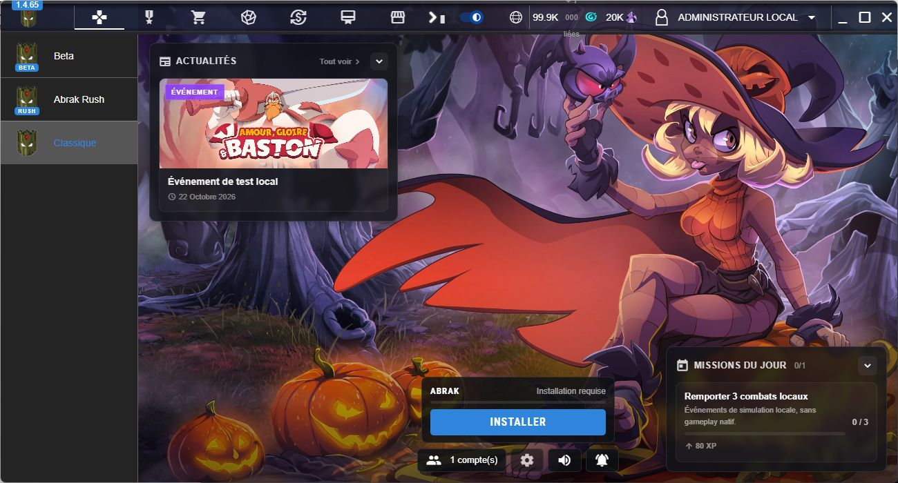
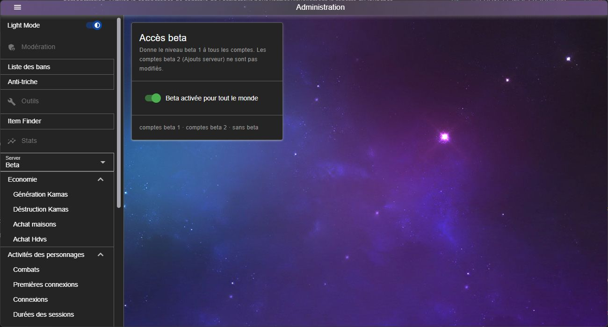
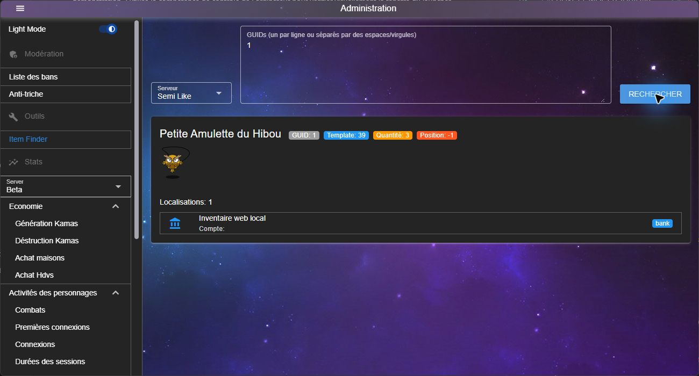

# Abrak Uplauncher ,

Adaptation locale de l’interface **Abrak Launcher 1.4.65**, avec application Windows, backend de démonstration et administration.



## Installer et lancer

Prérequis : **Windows x64**, **Node.js 24.15 ou supérieur**, npm et Git. Python 3.11 ou supérieur est utilisé pour publier les mises à jour du client et archiver les sources.

Cloner le dépôt, puis installer et compiler depuis sa racine :

```powershell
git clone https://github.com/KiraShironaga/Abrak-Uplauncher.git
cd Abrak-Uplauncher
npm ci
npm run setup
npm run build
npm run desktop
```

La compilation produit `dist/Abrak Launcher/`. Lancer avec `npm run desktop` ou `Lancer-local.cmd`, en conservant le reste du projet à côté. Pour les détails de compilation et le dépannage, consulter le [guide de compilation](docs/COMPILATION.md).

Pour le mode navigateur, exécuter `npm start`, puis ouvrir **http://127.0.0.1:4318/**. Le premier démarrage crée une base SQLite neuve et importe les catalogues fournis.

## Aperçu

- Interface et assets du launcher fournis.
- Recherches, catalogues et statistiques locales.
- Boutique, inventaire, monnaies et événements de démonstration.
- Administration, modération et recherche d’objets par GUID.
- Outils d’import du client, vérification des fichiers et publication des mises à jour.

Le client de jeu, l’émulateur, les bases privées et les connecteurs MySQL ne sont pas distribués. La base de démonstration du launcher est créée localement au premier lancement, avec des comptes fictifs. Les paiements, votes et associations Discord de cette copie sont des équivalents locaux de test. Les variantes Beta/Rush ne disposent pas de clients inclus.

**Pour utiliser ce launcher sur votre serveur, vous devez l’adapter à votre propre émulateur et à votre schéma de BDD.** Le [petit guide d’adaptation](docs/ADAPTER-SON-SERVEUR.md) indique où brancher les comptes, personnages, livraisons et tickets de connexion.

## Administration

Quitter le launcher déjà ouvert, puis lancer **`Administration.cmd`** ou :

```powershell
npm run admin
```

Accès navigateur : **http://127.0.0.1:4318/#/admin**. Le menu de gauche donne accès à **Modération**, **Item Finder**, aux statistiques et aux commandes d’administration.



Exemple de recherche d’un objet de démonstration par GUID :



## Comptes de démonstration

| Profil | Identifiant | Mot de passe |
| --- | --- | --- |
| Administrateur | `admin@local.test` | `LocalTest!2026` |
| Joueur | `joueur@local.test` | `LocalTest!2026` |

Le mode local ouvre automatiquement le compte administrateur fictif. Ces identifiants sont publics et réservés à la démonstration sur la machine locale. Ils ne doivent pas servir pour un service ouvert sur Internet.

L’anti-triche local consulte uniquement les signalements enregistrés dans la base de démonstration ; il ne collecte pas les processus du PC.

## Guides

- [Adapter le launcher à son émulateur et à sa BDD](docs/ADAPTER-SON-SERVEUR.md)
- [Compiler et lancer](docs/COMPILATION.md)
- [Brancher son client et publier des mises à jour](docs/CLIENT-ET-MISES-A-JOUR.md)
- [Fonctionnalités et administration](docs/FONCTIONNALITES.md)
- [Préparer la publication GitHub](docs/PUBLICATION.md)
- [Notices des composants tiers](THIRD_PARTY_NOTICES.md)

## Vérifier

```powershell
npm test
npm run verify
npm run check:publication
python -m unittest discover -s tools -p test_publish_client.py
```

Les tests vérifient les contrats HTTP, les droits, la persistance, les transactions et les garde-fous du client. La compilation vérifie l’ASAR et les empreintes des assets. Les tests exigeant un serveur natif sont ignorés lorsqu’aucun émulateur n’est configuré.

## Organisation et publication

`backend/` contient l’API et ses tests ; `source/app/` contient les bundles d’interface et assets ; `desktop/` et `tools/` contiennent l’adaptation et les outils. Les guides et captures sont dans `docs/`. Les sources du serveur de jeu sont exclues de la publication.

Les bases, comptes réels, profils, caches, installations de jeu, secrets, journaux, dépendances et exécutables générés sont exclus de Git et de l’archive des sources. Les configurations publiques sont des exemples ; les fichiers effectifs restent locaux.

Les fichiers d’interface fournis sont les **bundles compilés** du launcher, et non les composants Vue/TypeScript originaux. L’API locale, les adaptateurs et les outils sont fournis en sources lisibles. Les droits sur les éléments Abrak/Dofus et les notices tierces sont conservés ; aucune licence globale ne réattribue ces contenus. Leur redistribution suppose les autorisations correspondantes.
